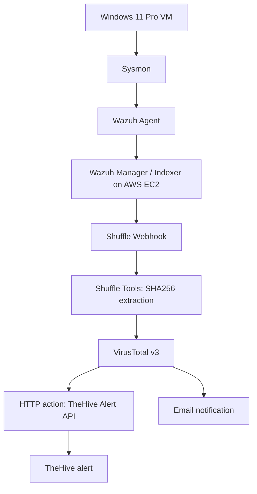

# AWS-Based SOC Automation Lab

**End-to-end endpoint monitoring, SIEM detection, threat-intelligence enrichment and alert automation**

| | |
|---|---|
| Author | Aryan Baloria |
| Project type | Hands-on SOC engineering lab |
| Endpoint | Windows 11 Pro VM (VirtualBox) |
| SIEM | Wazuh 4.14.10 on AWS EC2 |
| Telemetry | Sysmon 15.22 |
| SOAR | Shuffle Cloud |
| Threat intelligence | VirusTotal v3 |
| Alert management | TheHive 5.8.1-1 |
| Evidence period | November 2026 |

## Project overview

This project demonstrates an endpoint-to-alert workflow built and tested in an isolated lab. Sysmon generated Windows telemetry; the Wazuh agent collected the Sysmon Operational channel; a custom Wazuh rule detected a controlled `mimikatz.exe` process-execution event. Wazuh forwarded the alert to Shuffle, where a regex extracted the SHA-256 hash and VirusTotal returned a file report. Shuffle then branched to a generic HTTP action that created a TheHive alert and a separate Email action that sent a notification.

The captured successful Shuffle execution was marked `FINISHED`: SHA-256 extraction succeeded, VirusTotal returned HTTP `200`, TheHive returned HTTP `201`, and the Email action reported success.

## Architecture

The final workflow branches independently from VirusTotal to HTTP and Email. The email action is not downstream of the TheHive HTTP action. See [architecture](docs/architecture.md) and [workflow reference](playbooks/shuffle_workflow_reference.md).

## Lab environment

| Component | Recorded configuration |
|---|---|
| Endpoint | Windows 11 Pro VM in VirtualBox |
| Sysmon | Version `15.22` recorded; uploaded configuration schema `4.91` |
| Wazuh Agent | `wazah-agent-windows`, ID `001`, version `4.14.10` |
| Wazuh Manager | Ubuntu Server 24.04, Wazuh `4.14.10` |
| Wazuh Indexer | Wazuh `4.14.10` |
| Filebeat | `7.10.2` |
| SOAR | Shuffle Cloud |
| Threat intelligence | VirusTotal v3 |
| Alert management | TheHive `5.8.1-1` |

Wazuh and TheHive were deployed on separate EC2 instances in AWS region `ap-southeast-2` (Sydney). Public IP addresses, credentials and webhook URLs are excluded from the public artifacts.

## Detection use case

| Attribute | Verified value |
|---|---|
| Wazuh rule ID | `100002` |
| Wazuh level | `12` |
| Description | `SOC-Lab: Mimikatz execution detected on Windows endpoint.` |
| Match group | `sysmon_event1` |
| Match field | `win.eventdata.originalFileName` |
| Match | `(?i)mimikatz\.exe` |
| Event | Sysmon Event ID `1` — Process Create |
| Wazuh ATT&CK mapping | `T1003` — OS Credential Dumping |

The Sysmon event's `RuleName` metadata also contained `T1036` (Masquerading). That value comes from Sysmon configuration metadata and is distinct from the Wazuh rule's `T1003` mapping. The alert proves process execution, not successful credential dumping or credential compromise.

See [the actual custom rule](detections/wazuh_mimikatz_rule.xml), [validation record](detections/rule-validation.md), and [test cases](detections/test-cases.md).

## End-to-end validation

| Stage | Captured result |
|---|---|
| Sysmon | Event ID `1` captured for `mimikatz.exe` |
| Wazuh | Rule `100002`, Level `12`; alert ID `1794526316.3902037` |
| Shuffle Tools | `success: true`, `found: true` for SHA-256 extraction |
| VirusTotal | HTTP `200`, `success: true`; five sandbox verdicts categorized malicious |
| TheHive | HTTP `201`; alert ID `~1192048`; `observableCount: 0` |
| Email | Shuffle Email action reported `Email was successfully sent` |

See the [SOC incident report](SOC-Project-Report.md) and [evidence index](docs/evidence-index.md) for provenance and caveats.

## Security observations

The 13 November 2026 AWS screenshots showed TheHive TCP `9000` open to `0.0.0.0/0`, and Wazuh TCP `1514` and `1515` open to `0.0.0.0/0`. The workflow export also showed an unauthenticated POST webhook trigger and HTTP communication to TheHive. These are recorded security findings, not changes made by this project package. See [security review](docs/security-review.md).

The raw Shuffle export contained sensitive configuration values and is not included. A sanitized, non-importable reference export is provided instead. Sanitization does not revoke or rotate live credentials.

## Repository guide

| Path | Purpose |
|---|---|
| [`SOC-Project-Report.md`](SOC-Project-Report.md) | Complete analyst-style project report |
| [`docs/architecture.md`](docs/architecture.md) | Architecture and data flow |
| [`docs/walkthrough.md`](docs/walkthrough.md) | Implementation walkthrough |
| [`docs/soc-incident-report.md`](docs/soc-incident-report.md) | Correlated SOC investigation report |
| [`docs/troubleshooting.md`](docs/troubleshooting.md) | Build issues and recorded workarounds |
| [`docs/security-review.md`](docs/security-review.md) | AWS and workflow security observations |
| [`docs/evidence-index.md`](docs/evidence-index.md) | Screenshot and sample provenance |
| [`detections/`](detections/README.md) | Actual Wazuh rule and validation evidence |
| [`configurations/`](configurations/README.md) | Windows agent excerpt and actual Sysmon config |
| [`playbooks/`](playbooks/shuffle_workflow_reference.md) | Workflow reference and incident-response playbooks |
| [`samples/`](samples/wazuh-alert-100002.json) | Sanitized JSON and output captures |
| [`threat-intelligence/`](threat-intelligence/mimikatz-hash-analysis.md) | Hash enrichment analysis |
| [`screenshots/`](screenshots/README.md) | Selected sanitized evidence images |

## Limitations

- The workflow creates a TheHive alert, not a case.
- No observables were attached to the returned TheHive alert (`observableCount: 0`).
- Endpoint isolation, process termination and automated remediation were not implemented.
- Negative/false-positive test results were not provided.
- Production retry, deduplication and failure-handling behavior was not fully implemented or validated.
- The uploaded Shuffle export's later validation metadata shows an HTTP `400` issue on HTTP 1; this is separate from the earlier successful run returning HTTP `201`.
- VirusTotal aggregate `last_analysis_stats` values were not visible in the copied output; no detection ratio is claimed.

## Author

**Aryan Baloria**  
GitHub: [aryazz-labs](https://github.com/aryazz-labs)  
LinkedIn: [aryan-baloria](https://www.linkedin.com/in/aryan-baloria/)
