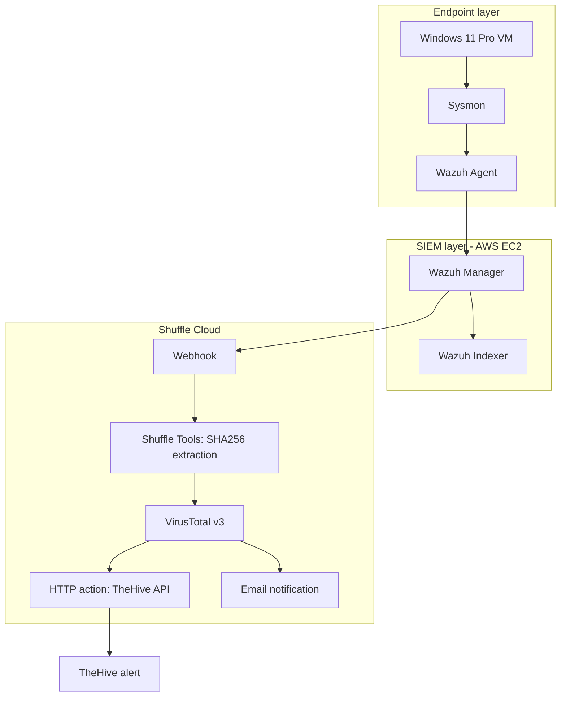

# SOC Automation Lab — Architecture

The diagram below shows the end-to-end flow from Windows endpoint monitoring to automated threat intelligence enrichment, TheHive alert creation, and email notification.

