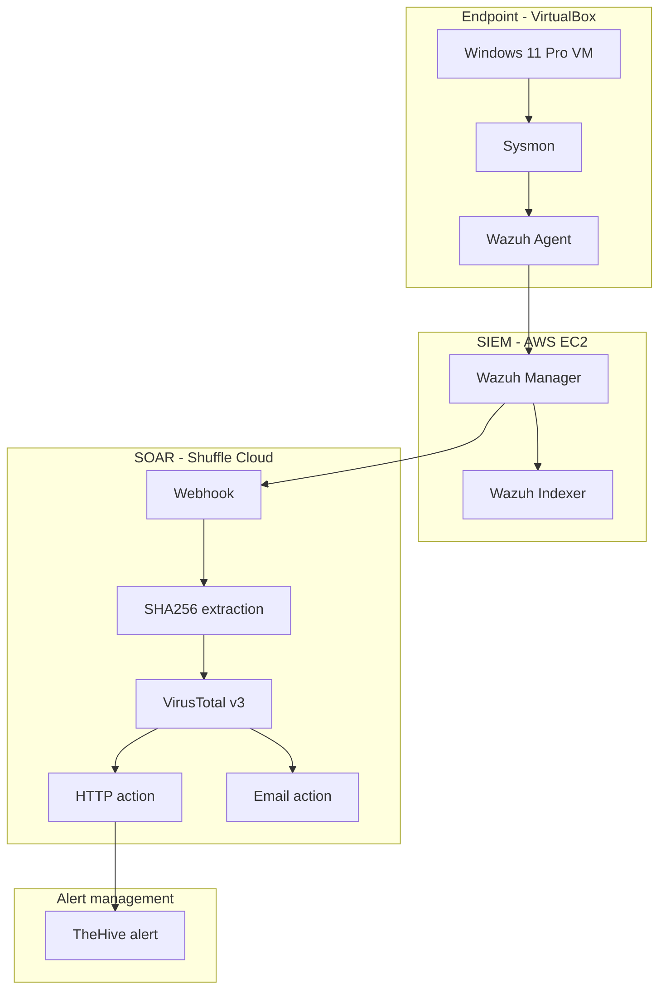

# AWS-Based SOC Automation Lab

**End-to-end endpoint monitoring, SIEM detection, threat-intelligence enrichment, and alert automation**

| | |
|---|---|
| Author | Aryan Baloria |
| Endpoint | Windows 11 Pro VM (VirtualBox) |
| SIEM | Wazuh 4.14.10 on AWS EC2 |
| Telemetry | Sysmon |
| SOAR | Shuffle Cloud |
| Threat intelligence | VirusTotal v3 |
| Alert management | TheHive 5.8.1 |

> This repository documents a hands-on lab implementation: endpoint telemetry collection, SIEM detection, SOAR orchestration, hash enrichment, TheHive alert creation, and email notification.

## Project overview

A Windows 11 Pro VM was monitored using Sysmon and the Wazuh agent. Wazuh collected the Sysmon Operational event channel and evaluated custom rule `100002` (Level `12`) during a controlled `mimikatz.exe` process-execution test.

The selected alert was forwarded to Shuffle. The workflow extracted the SHA256 hash, queried VirusTotal v3, and then branched into two independent actions: an HTTP request to TheHive's alert API and a separate email notification.

The project record reports VirusTotal HTTP `200`, TheHive HTTP `201` alert creation, a visible TheHive alert, and email delivery. The email delivery is owner-reported; an inbox screenshot was not recovered.

## Architecture

**Workflow detail:** The final recovered Shuffle canvas shows HTTP and Email as separate branches from VirusTotal. Email does not depend on the TheHive HTTP action. See [architecture documentation](docs/architecture.md).

## Lab environment

| Component | Recorded configuration |
|---|---|
| Endpoint | Windows 11 Pro VM in VirtualBox |
| Sysmon | Endpoint telemetry; Sysmon Operational channel |
| Wazuh Agent | `wazah-agent-windows`, ID `001`, version `4.14.10` |
| Wazuh Manager | AWS EC2, Ubuntu Server 24.04, Wazuh `4.14.10` |
| Wazuh Indexer | Wazuh `4.14.10` |
| Filebeat | `7.10.2` |
| SOAR | Shuffle Cloud |
| Threat intelligence | VirusTotal v3 |
| Alert management | TheHive `5.8.1-1` |

Wazuh and TheHive were deployed on separate EC2 instances in AWS region `ap-southeast-2` (Sydney). Public IP addresses and credentials are omitted.

## Detection use case

| Attribute | Observed value |
|---|---|
| Wazuh rule ID | `100002` |
| Alert level | `12` |
| Description | `SOC-Lab: Mimikatz execution detected on Windows endpoint.` |
| Event source | Sysmon Event ID `1` (Process Create) |
| Process | `mimikatz.exe` |
| Parent process | Windows PowerShell |
| File version | `2.2.0.0` |
| SHA256 | `61C0810A23580CF492A6BA4F7654566108331E7A4134C968C2D6A05261B2D8A1` |

This controlled test demonstrates process execution, not successful credential dumping or credential compromise. The exact deployed rule XML has not yet been recovered; see [detection notes](detections/README.md).

## Automation workflow

1. Webhook receives the selected Wazuh alert.
2. Shuffle Tools extracts SHA256 using `SHA256=([0-9A-Fa-f]{64})`.
3. VirusTotal v3 looks up the hash.
4. HTTP action sends a structured alert to TheHive's `/api/v1/alert` endpoint.
5. Email action sends a separate notification.

The generic HTTP action was used after the native Shuffle TheHive action encountered a compatibility/parameter issue. TheHive alert creation is not the same as case creation. See [Shuffle workflow reference](playbooks/shuffle_workflow_reference.md).

## Validation and evidence

| Validation | Recorded result | Evidence |
|---|---|---|
| Wazuh agent | Agent `001` shown Active | [Screenshot](screenshots/01-wazuh-agent-active.png) |
| Sysmon collection | Sysmon Operational events searchable in Wazuh; 46 hits shown | [Screenshot](screenshots/02-sysmon-events-in-wazuh.png) |
| SHA256 extraction | Shuffle Tools `SUCCESS`, `found: true` | [Screenshot](screenshots/03-shuffle-sha256-extraction.png) |
| VirusTotal | HTTP `200`; file object returned | [Screenshot](screenshots/04-virustotal-http-200.png) |
| Workflow topology | HTTP and Email shown as separate VirusTotal branches | [Screenshot](screenshots/05-shuffle-workflow.png) |
| TheHive | Created alert visible | [Screenshot](screenshots/06-thehive-alert-created.png) |
| Email delivery | Reported received by project owner | Inbox screenshot unavailable |

See [the evidence index](docs/evidence-index.md) for screenshot scope and limitations.

## Repository guide

| Path | Purpose |
|---|---|
| [Architecture](docs/architecture.md) | Architecture, data flow, trust boundaries |
| [Walkthrough](docs/walkthrough.md) | Implementation walkthrough |
| [Alert investigation](docs/alert-investigation.md) | SOC investigation record |
| [Troubleshooting](docs/troubleshooting.md) | Issues and recorded workarounds |
| [Evidence index](docs/evidence-index.md) | Screenshot evidence and limitations |
| [Detections](detections/README.md) | Wazuh detection notes |
| [Configurations](configurations/README.md) | Sanitized configuration excerpts |
| [Shuffle playbook](playbooks/shuffle_workflow_reference.md) | Workflow reference |
| [Screenshots](screenshots/README.md) | Recovered visual evidence |
| [Security notes](SECURITY-NOTES.md) | Security and publication notes |

## Security considerations and limitations

- TheHive API was tested over HTTP on port `9000`; HTTP does not encrypt credentials or alert data in transit. Use HTTPS beyond an isolated lab.
- Restrict TheHive inbound access to trusted sources. A historical lab screenshot showed port `9000` configured broadly; verify the current AWS security-group rule and remove any `0.0.0.0/0` exposure.
- A previously uploaded Shuffle configuration screenshot contained a bearer credential and is intentionally excluded. Revoke/rotate it if still active.
- Keep API keys in Shuffle credential storage. Never commit tokens, authorization headers, passwords, private keys, or webhook URLs.
- VirusTotal HTTP `200` means the API returned a report; it is not itself a malware verdict.
- The workflow creates a TheHive **alert**, not a case.
- Automated endpoint isolation, process termination, and remediation were not implemented.
- Production-grade retries, deduplication, and failure handling were not implemented or fully tested. A duplicate source reference was observed to return HTTP `400`.
- The exact deployed Wazuh rule XML and Shuffle workflow JSON exports are not currently included. They must be exported from the live systems; no mock exports are presented as deployed configuration.

## Author

**Aryan Baloria**  
GitHub: [aryazz-labs](https://github.com/aryazz-labs)  
LinkedIn: [aryan-baloria](https://www.linkedin.com/in/aryan-baloria/)
