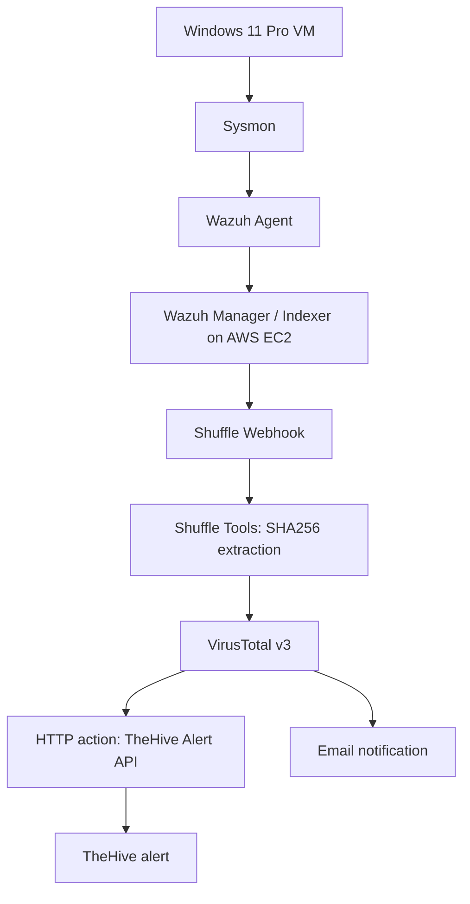

# AWS-Based SOC Automation Lab
## End-to-End Endpoint Monitoring, Threat Intelligence Enrichment, and Alert Automation

**Author:** Aryan Baloria  
**Project type:** Hands-on SOC engineering / home lab  
**Environment:** Windows 11 Pro (VirtualBox), AWS EC2, Sysmon, Wazuh 4.14.10, Shuffle Cloud, VirusTotal v3, TheHive 5.8.1

> This repository documents a lab implementation built and tested by the author. It demonstrates endpoint telemetry collection, SIEM detection, SOAR workflow construction, hash enrichment, TheHive alert creation, and analyst notification.

## Project overview

I built a monitoring and alert-automation pipeline around a Windows 11 Pro virtual machine. Sysmon generated endpoint telemetry, the Wazuh agent collected the Sysmon Operational channel, and a custom Wazuh rule (ID `100002`, Level 12) generated an alert for a controlled `mimikatz.exe` process-execution test. The alert was passed to Shuffle, where a regular expression extracted the SHA256 hash and VirusTotal was queried. Shuffle then sent a structured alert to TheHive through its REST API and sent an email notification.

The project notes record a successful VirusTotal HTTP 200 response, TheHive HTTP 201 alert creation, a visible TheHive alert, and email delivery. Screenshots from the project conversation independently show the active Wazuh agent, Sysmon-channel events in Wazuh, successful SHA256 extraction, VirusTotal HTTP 200, the workflow graph, and a created TheHive alert, email-inbox screenshot .

## Architecture



The screenshot shows the Email and HTTP actions as separate branches from the VirusTotal node. TheHive is called by the generic HTTP action. See [docs/architecture.md](docs/architecture.md).

## Environment

| Component | Recorded configuration / role |
|---|---|
| Endpoint | Windows 11 Pro VM in VirtualBox |
| Sysmon | Process and system telemetry; Sysmon Operational channel |
| Wazuh Agent | `wazah-agent-windows`, ID `001`, version `4.14.10` |
| Wazuh Manager | AWS EC2, Ubuntu Server 24.04, Wazuh `4.14.10` |
| Wazuh Indexer | Wazuh `4.14.10` |
| Filebeat | `7.10.2` |
| SOAR | Shuffle Cloud |
| Threat intelligence | VirusTotal v3 |
| Alert management | TheHive `5.8.1-1`, organization `Aryan-SOC-Automation` |

The Wazuh and TheHive instances were deployed separately in AWS region `ap-southeast-2` (Sydney). Public IPs and credentials are intentionally omitted.

## Detection use case

- Custom Wazuh rule ID: `100002`
- Alert level: `12`
- Description: `SOC-Lab: Mimikatz execution detected on Windows endpoint.`
- Event source: Sysmon Process Create (Event ID 1)
- Observed process: `mimikatz.exe`
- Observed parent: Windows PowerShell
- Observed file version: `2.2.0.0`
- SHA256: `61C0810A23580CF492A6BA4F7654566108331E7A4134C968C2D6A05261B2D8A1`


## Shuffle workflow

1. `Webhook 1` receives the Wazuh alert.
2. `Shuffle Tools 1` extracts the SHA256 value.
3. `VirusTotal v3 1` queries the hash.
4. `HTTP 1` sends a structured alert to TheHive's alert endpoint.
5. `Email 1` sends a notification.

The recovered final workflow screenshot shows Email and HTTP as separate outgoing branches from VirusTotal. Hash extraction used:

```regex
SHA256=([0-9A-Fa-f]{64})
```

The native Shuffle TheHive action produced a connection/compatibility issue. The generic HTTP action was used for the REST API integration. See [playbooks/shuffle_workflow_reference.md](playbooks/shuffle_workflow_reference.md).

## Validation recorded

| Validation | Evidence / result |
|---|---|
| Windows agent connected | Wazuh dashboard screenshot shows agent `001` Active |
| Sysmon event collection | Wazuh event search screenshot filtered to Sysmon Operational; 46 hits shown |
| SHA256 extraction | Shuffle Tools screenshot shows `SUCCESS`, `found: true`, and captured hash |
| VirusTotal lookup | Shuffle action screenshot shows HTTP `200` and file object returned |
| TheHive alert | Screenshot shows alert title, High severity, Wazuh source, tags, and description |
| Email notification | Delivery was reported during project work; no inbox screenshot recovered |
| Wazuh custom-rule view | Rule ID/level are recorded in the report and TheHive alert description; standalone Wazuh alert screenshot not recovered |

See [docs/evidence-index.md](docs/evidence-index.md) for screenshot provenance and limitations.

## Repository structure

```text
SOC-Automation-Lab-Portfolio/
├── README.md
├── docs/
│   ├── architecture.md
│   ├── walkthrough.md
│   ├── troubleshooting.md
│   ├── alert-investigation.md
│   └── evidence-index.md
├── detections/
│   └── README.md
├── playbooks/
│   └── shuffle_workflow_reference.md
├── configurations/
│   ├── README.md
│   └── ossec.conf.example
├── screenshots/
│   └── recovered evidence images
└── .gitignore
```

## Security considerations and limitations

- TheHive API was tested over HTTP on port `9000`; HTTP does not encrypt credentials or alert data in transit. HTTPS should be configured.
- Restrict TheHive inbound access to trusted sources. A historical lab screenshot showed port `9000` configured broadly; verify the current AWS security-group rule and remove any `0.0.0.0/0` exposure.
- A previously uploaded Shuffle configuration screenshot visibly contained a bearer credential. It is deliberately excluded from this repository. If that credential is still active, revoke/rotate it before further use.
- Keep API keys in Shuffle's secret/credential storage and never commit them.
- VirusTotal reputation is enrichment, not a definitive malware verdict.
- The workflow creates a TheHive **alert**, not a case.
- Automated endpoint isolation, process termination, and remediation were not implemented.
- Production-grade retries, deduplication, and failure handling were not implemented or fully tested. A duplicate source reference was observed to return HTTP 400.
- The exact Wazuh rule XML and Shuffle workflow JSON exports were not recovered; no invented exports are included.


## Author

**Aryan Baloria**  
GitHub: [aryazz-labs](https://github.com/aryazz-labs)  
LinkedIn: [aryan-baloria](https://www.linkedin.com/in/aryan-baloria/)
