# AWS-Based SOC Automation Lab

**A hands-on SOC automation lab with Sysmon, Wazuh, Shuffle, VirusTotal and TheHive.**

I built this lab to understand what happens *after* a suspicious event appears on an endpoint: how that event reaches a SIEM, how an analyst can enrich it, and how the result can be sent to an alert-management platform and an inbox.

The test was performed in an isolated Windows 11 Pro virtual machine. I used a controlled `mimikatz.exe` process-execution event to exercise the pipeline from endpoint telemetry through notification. This is a learning lab, not a production deployment.

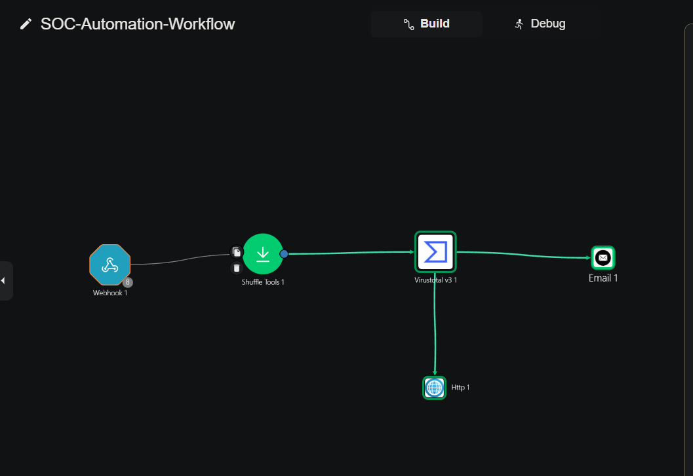

## At a glance

| Part of the lab | What I used |
|---|---|
| Endpoint | Windows 11 Pro VM in VirtualBox |
| Endpoint telemetry | Sysmon 15.22 |
| SIEM | Wazuh Manager and Indexer 4.14.10 on AWS EC2 |
| Automation | Shuffle Cloud |
| Threat intelligence | VirusTotal v3 |
| Alert management | TheHive 5.8.1-1 |
| Notification | Shuffle Email action |

## What happens when the test runs?

Here is the path the event takes through the lab:

1. **Windows generates the event.** Sysmon records a Process Create event (Event ID 1) for `mimikatz.exe`.
2. **Wazuh evaluates it.** The Windows agent forwards Sysmon telemetry to the Wazuh Manager. Custom rule `100002` matches the event and raises a Level `12` alert.
3. **Shuffle receives the alert.** The webhook starts the workflow, and Shuffle Tools extracts the SHA-256 hash.
4. **VirusTotal enriches the hash.** Shuffle queries the VirusTotal v3 file report.
5. **The workflow splits into two actions.** One branch sends an HTTP request to create a TheHive alert; the other sends an email notification. The email action is independent of the TheHive HTTP action.

The saved workflow and the captured Debug run confirm this branch layout.

## Architecture

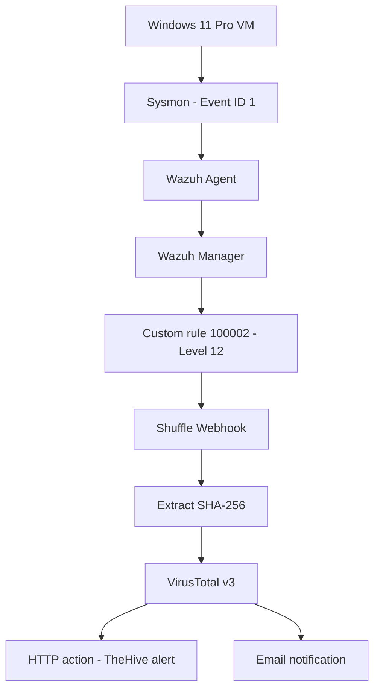

## The detection I tested

The custom Wazuh rule is stored in [`detections/wazuh_mimikatz_rule.xml`](detections/wazuh_mimikatz_rule.xml). It looks for the original filename field in Sysmon Event ID 1 events:

| Rule detail | Observed value |
|---|---|
| Rule ID | `100002` |
| Wazuh level | `12` |
| Event group | `sysmon_event1` |
| Field | `win.eventdata.originalFileName` |
| Match expression | `(?i)mimikatz\.exe` |
| Wazuh ATT&CK mapping | `T1003` — OS Credential Dumping |

One detail worth keeping clear: the Sysmon event's own `RuleName` metadata contained `T1036` (Masquerading). That is separate from the `T1003` mapping in my Wazuh rule.

The captured event confirms that the process ran. It does **not** prove that credentials were successfully dumped or that credentials were compromised.

## What the captured run showed

These are the results recorded during the successful Shuffle Debug execution:

| Stage | Captured result |
|---|---|
| Sysmon | Process Create event for `mimikatz.exe` |
| Wazuh | Rule `100002`, Level `12`; alert ID `1794526316.3902037` |
| Shuffle Tools | SHA-256 extraction: `success: true`, `found: true` |
| VirusTotal | HTTP `200`; file report returned |
| TheHive | HTTP `201`; alert ID `~1192048`; severity label `HIGH` |
| Email | Shuffle reported: `Email was successfully sent` |

The TheHive response reported `observableCount: 0`: the alert was created, but no observables were attached. The workflow created a TheHive **alert**, not a case.

## A few screenshots from the build

These are selected snapshots from the actual lab. The [evidence index](docs/evidence-index.md) contains the full set, context and limitations.

<table>
  <tr>
    <td width="50%">
      <a href="screenshots/01-wazuh-agent-active.png">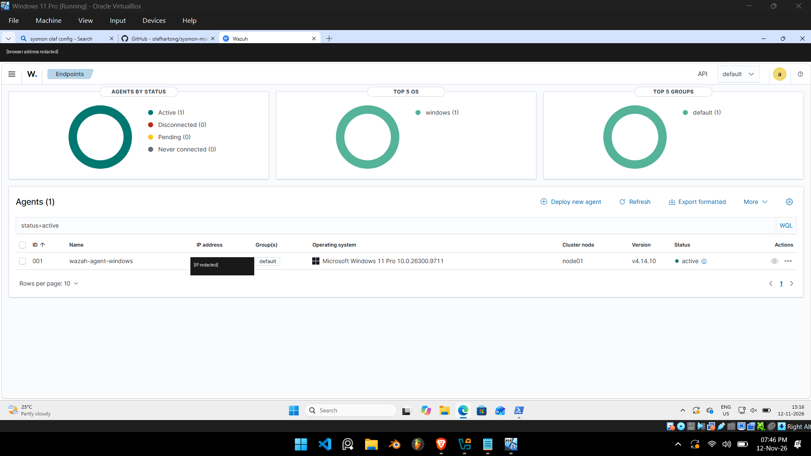</a>
      <b>01 · Agent connected</b> Windows agent 001 shown as Active in Wazuh.
    </td>
    <td width="50%">
      <a href="screenshots/08-sysmon-event-id-1.png">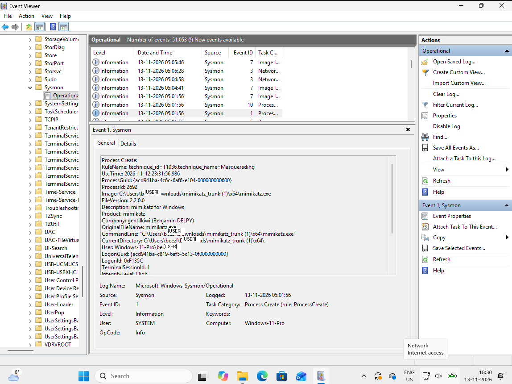</a>
      <b>02 · Endpoint event</b> Sysmon Process Create event for mimikatz.exe.
    </td>
  </tr>
  <tr>
    <td width="50%">
      <a href="screenshots/09-wazuh-rule-100002-alert.png">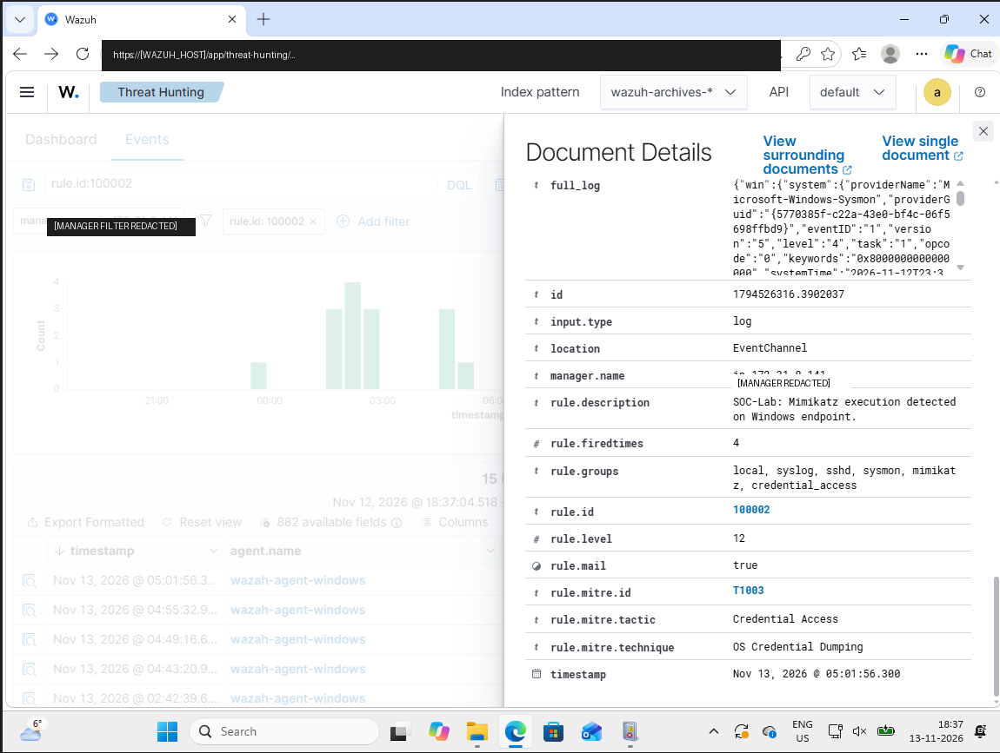</a>
      <b>03 · SIEM detection</b> Wazuh rule 100002, Level 12, with T1003 mapping.
    </td>
    <td width="50%">
      
      <b>04 · Workflow layout</b> VirusTotal branches to TheHive HTTP and Email actions.
    </td>
  </tr>
  <tr>
    <td width="50%">
      <a href="screenshots/12-shuffle-virustotal-success.png">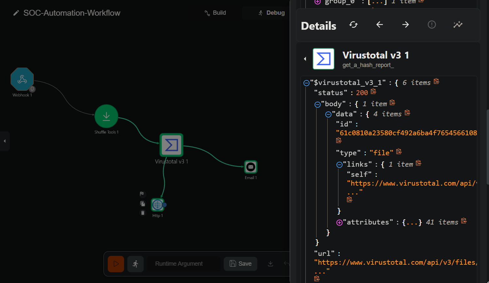</a>
      <b>05 · Threat-intelligence lookup</b> VirusTotal node returned HTTP 200.
    </td>
    <td width="50%">
      <a href="screenshots/13-shuffle-thehive-and-email-success.png">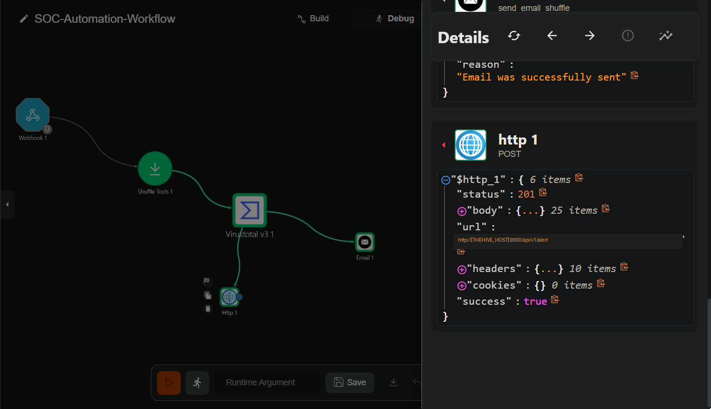</a>
      <b>06 · Automation result</b> TheHive returned HTTP 201 and the Email action reported success.
    </td>
  </tr>
</table>

## The AWS side of the lab

The SIEM and alert-management parts of this project ran on separate EC2 instances. I included the AWS console view as well, so the infrastructure behind the workflow is visible—not just the tools running inside it. These are point-in-time screenshots from **13 November 2026**. In the instance overview, the Wazuh server was **Running** and the Hive server was **Stopped** at the moment of capture. The account, instance, security-group and public-address identifiers have been redacted; the server names and observed states are retained.

  <a href="screenshots/17-aws-ec2-instances-overview.png">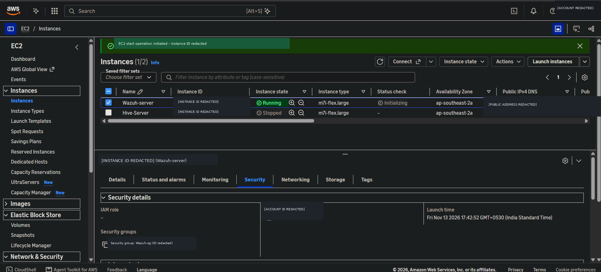</a>

<b>08 · EC2 instances</b> Wazuh-server was Running; Hive-Server was Stopped in this captured view. This is a historical snapshot, not a statement of current instance state.

The next two screenshots show the inbound security-group rules captured during the same review. I kept the broad source ranges visible because they are part of the security findings discussed below.

<table>
  <tr>
    <td width="50%">
      <a href="screenshots/14-aws-wazuh-security-group-review.png">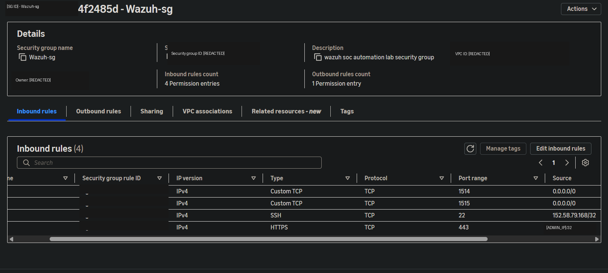</a>
      <b>09 · Wazuh security group</b> Inbound TCP 1514 and 1515 were shown as open to 0.0.0.0/0 in this capture.
    </td>
    <td width="50%">
      <a href="screenshots/15-aws-thehive-security-group-review.png">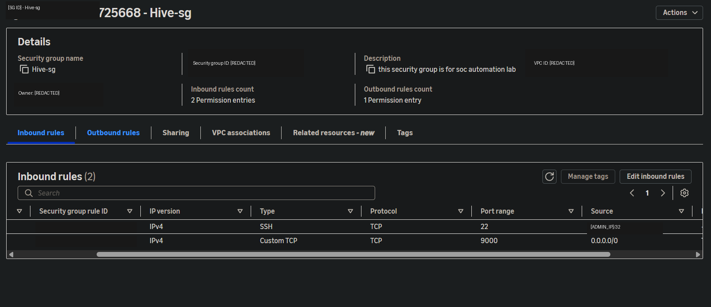</a>
      <b>10 · TheHive security group</b> Inbound TCP 9000 was shown as open to 0.0.0.0/0 in this capture.
    </td>
  </tr>
</table>

**The notification also arrived in Gmail:**

  <a href="screenshots/16-email-notification-received.png">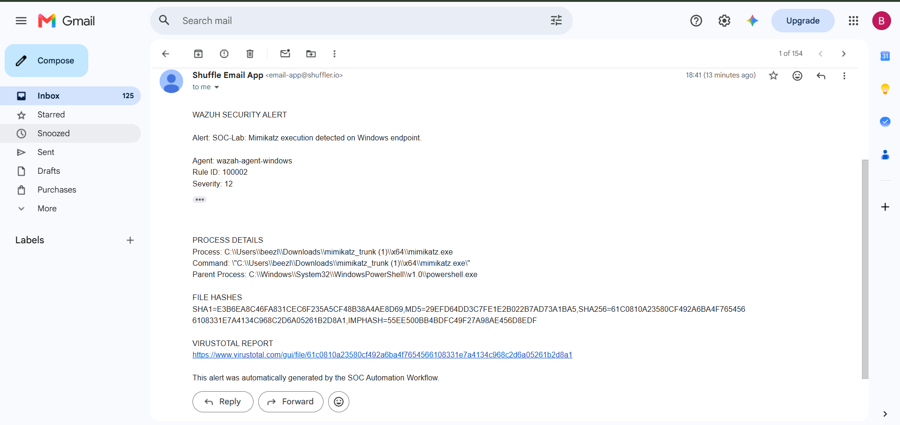</a>

11 · Email notification received from the Shuffle Email App.

## What I learned (including the rough edges)

This build involved more than connecting five boxes on a canvas. I had to get the Windows event channel into Wazuh, validate the custom rule, extract the hash in Shuffle, work around a compatibility issue with the native TheHive action, and use a generic HTTP request to create the alert.

There are also things I have **not** claimed or implemented:

- The workflow creates a TheHive alert, not a case, and the returned alert had zero observables.
- Endpoint isolation, process termination and automated remediation are not implemented.
- A benign-process / false-positive test was not recorded.
- Production-grade retry, deduplication and failure handling were not fully implemented or validated.
- The successful Debug run returned HTTP `201` from TheHive. A later validation record in the exported workflow showed an HTTP `400` issue for the HTTP node; the available evidence does not establish its cause.
- The copied VirusTotal output did not expose aggregate `last_analysis_stats`, so I do not claim an antivirus detection ratio.

## Security notes

The AWS security-group screenshots captured on 13 November 2026 showed:

- TheHive TCP `9000` open to `0.0.0.0/0`.
- Wazuh TCP `1514` and `1515` open to `0.0.0.0/0`.

The saved workflow also used an unauthenticated POST webhook trigger and HTTP (not HTTPS) for TheHive API communication. These are documented findings from the captured configuration, not changes made by this repository. The screenshots describe the configuration at capture time and do not establish the current AWS rules.

The raw Shuffle export is intentionally excluded because it contained sensitive configuration values. The repository includes a sanitized, **non-importable** reference copy instead. Sanitizing a file for publication does not revoke a live credential.

See [the security review](docs/security-review.md) and [maintainer security notes](SECURITY-NOTES.md).

## Explore the repository

| Folder / file | What's inside |
|---|---|
| [`SOC-Project-Report.md`](SOC-Project-Report.md) | Full analyst-style project report |
| [`docs/`](docs/README.md) | Architecture, walkthrough, investigation, troubleshooting and evidence index |
| [`detections/`](detections/README.md) | Deployed Wazuh rule, validation record and test cases |
| [`configurations/`](configurations/README.md) | Sanitized Windows agent config and Sysmon configuration |
| [`playbooks/`](playbooks/shuffle_workflow_reference.md) | Sanitized Shuffle reference and response playbooks |
| [`samples/`](samples/wazuh-alert-100002.json) | Sanitized Wazuh, VirusTotal, TheHive and Shuffle evidence |
| [`threat-intelligence/`](threat-intelligence/mimikatz-hash-analysis.md) | Hash enrichment assessment |
| [`screenshots/`](screenshots/README.md) | Screenshot evidence and index |

## Lab environment

The endpoint ran in VirtualBox. Wazuh Manager/Indexer and TheHive ran on separate AWS EC2 instances in `ap-southeast-2` (Sydney). The recorded versions were Wazuh `4.14.10`, Filebeat `7.10.2`, Sysmon `15.22` and TheHive `5.8.1-1`.

The uploaded Sysmon configuration has schema version `4.91`. The project history records it as the file supplied to the initial Sysmon installation command; an installation-time checksum was not captured, so byte-for-byte identity with the historical installed file cannot be independently proven.

## About this project

I'm Aryan Baloria, a B.Tech CSE student building practical security labs to strengthen my SOC and detection-engineering skills.

- GitHub: [aryazz-labs](https://github.com/aryazz-labs)
- LinkedIn: [aryan-baloria](https://www.linkedin.com/in/aryan-baloria/)

*Built, tested, documented and learned from one event at a time.*
