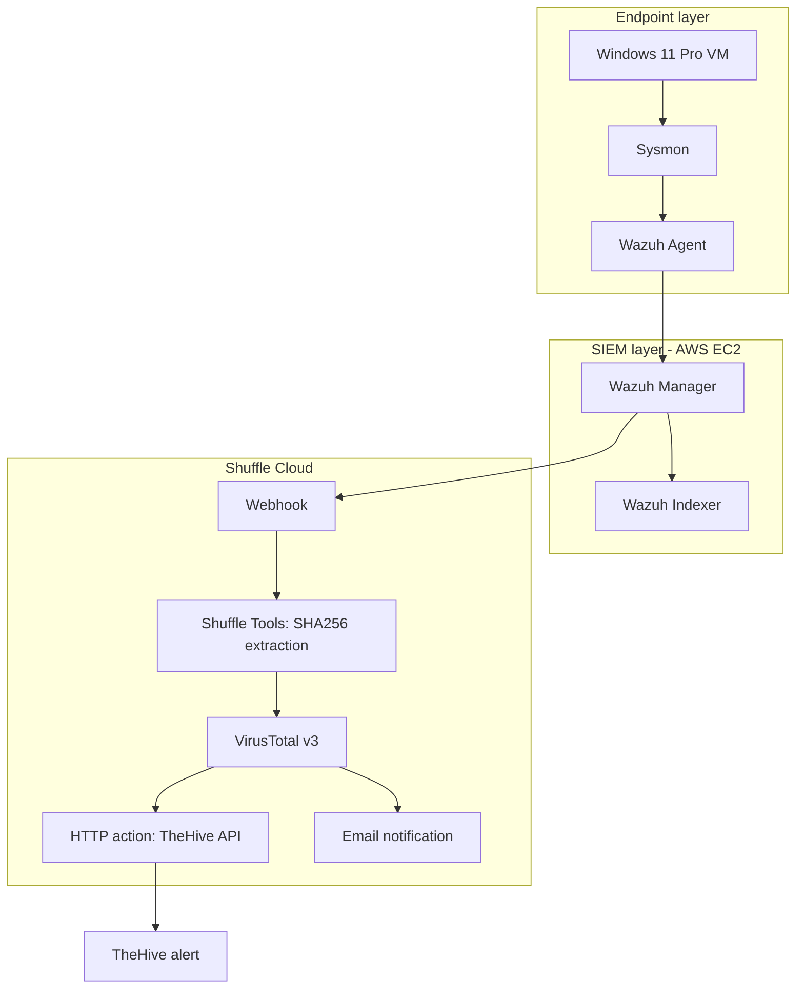

# Architecture and Data Flow

## Overview

The lab uses a Windows 11 Pro VM as the monitored endpoint. Sysmon records process telemetry, the Wazuh agent collects the Sysmon Operational channel, and the Wazuh Manager evaluates the events. A selected Wazuh alert is sent to Shuffle Cloud. Shuffle extracts the SHA256 hash, queries VirusTotal, then branches to a generic HTTP action for TheHive alert creation and an email notification action.

## Logical architecture

**Workflow topology note:** The recovered final Shuffle canvas shows VirusTotal connected separately to `HTTP 1` and `Email 1`. 

## Component responsibilities

| Component | Responsibility |
|---|---|
| Windows 11 Pro VM | Isolated endpoint and controlled test environment |
| Sysmon | Process creation and other detailed endpoint telemetry |
| Wazuh Agent | Collects the Sysmon Operational event channel |
| Wazuh Manager | Evaluates events and detection rules |
| Wazuh Indexer | Stores searchable security data |
| Shuffle Cloud | Receives and orchestrates selected alerts |
| VirusTotal v3 | Provides file-hash reputation enrichment |
| HTTP action | Calls TheHive's alert creation REST endpoint |
| TheHive | Stores the resulting security alert |
| Email action | Sends a separate analyst notification |

## Deployment notes

- Wazuh and TheHive were deployed on separate AWS EC2 instances in Sydney (`ap-southeast-2`).
- Server operating system recorded: Ubuntu Server 24.04.
- Endpoint: Windows 11 Pro in VirtualBox.
- Wazuh Manager and Indexer: `4.14.10`; Filebeat: `7.10.2`.
- TheHive UI showed version `5.8.1-1`.
- Shuffle was cloud-hosted.

## Event flow

1. Sysmon records a process-creation event.
2. Wazuh Agent collects `Microsoft-Windows-Sysmon/Operational`.
3. Wazuh Manager evaluates the event and generates the custom Level 12 alert under rule `100002`.
4. The alert reaches the Shuffle webhook.
5. Shuffle Tools extracts the SHA256 value using `SHA256=([0-9A-Fa-f]{64})`.
6. VirusTotal v3 returns a successful HTTP `200` file-report response.
7. The workflow branches: `HTTP 1` posts a structured alert to TheHive's `/api/v1/alert` endpoint, while `Email 1` sends the notification.
8. TheHive stores an alert in the `Aryan-SOC-Automation` organization. This is alert creation, not case creation.

## Trust boundaries and security

The endpoint-to-SIEM connection, cloud SOAR, third-party threat-intelligence API, TheHive API, and email provider are separate trust boundaries. Use TLS, restrict inbound security-group rules, store credentials in a secret manager, and redact sensitive values from screenshots and exports.
