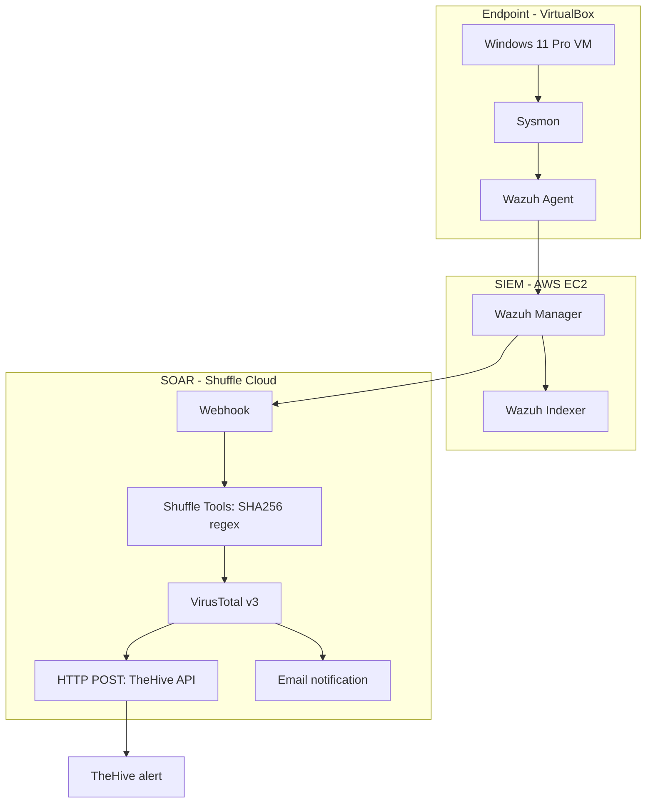

# Architecture and data flow

## Logical architecture

**Branch topology:** In the saved workflow, VirusTotal branches independently to the generic HTTP action and the Email action. Email is not downstream of the TheHive HTTP action.

## Component roles

| Component | Role |
|---|---|
| Windows 11 Pro VM | Controlled endpoint used for the process-execution test |
| Sysmon 15.22 | Generates Windows telemetry, including Process Create events |
| Wazuh Agent 4.14.10 | Collects Application, Security, System and Sysmon Operational channels |
| Wazuh Manager 4.14.10 | Applies rule `100002` and forwards alerts |
| Wazuh Indexer 4.14.10 | Stores searchable alert/event data |
| Shuffle Cloud | Orchestrates the workflow |
| Shuffle Tools | Extracts a 64-character SHA256 value with regex |
| VirusTotal v3 | Looks up the file hash |
| HTTP action | Creates a TheHive alert via REST API |
| Email action | Sends a notification independently |
| TheHive 5.8.1-1 | Stores the resulting alert object |

## Trust boundaries

1. Windows endpoint to Wazuh Manager (TCP 1514).
2. Wazuh Manager to Shuffle Cloud (webhook trigger).
3. Shuffle Cloud to VirusTotal v3 (API).
4. Shuffle Cloud to TheHive (HTTP API on port 9000 in the observed configuration).
5. Shuffle Cloud to the email provider.

The saved webhook trigger describes an unauthenticated POST input. The observed TheHive API URL uses HTTP. Both are documented security constraints; neither was modified as part of this evidence package.
