# Evidence index and provenance

Screenshots are point-in-time evidence. The two AWS security-group screenshots and the Wazuh dashboard screenshot are sanitized public copies; original source images are retained outside the public repository build.

| Screenshot | What it supports | Notes |
|---|---|---|
| 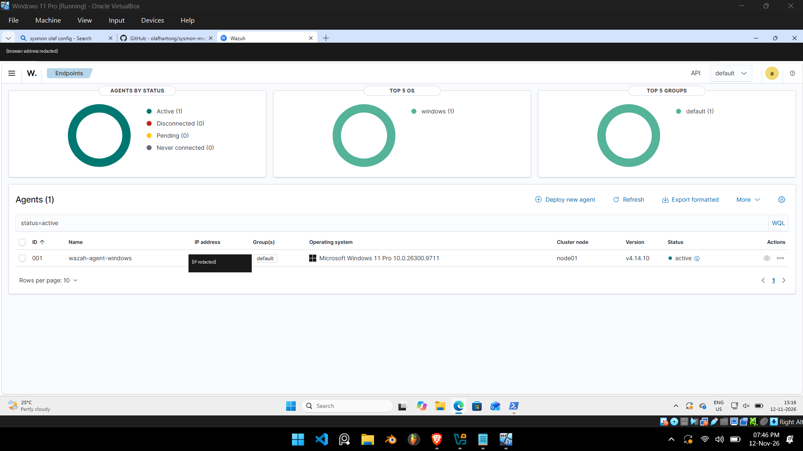 | Wazuh agent `001` shown Active | Existing recovered screenshot |
| 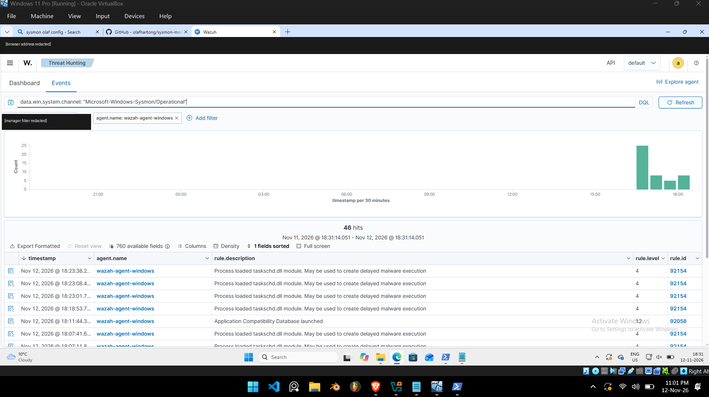 | Sysmon Operational events searchable in Wazuh; 46 hits shown | Existing recovered screenshot |
| 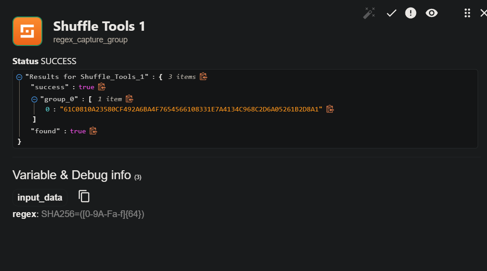 | Regex capture returned `SUCCESS` / `found: true` | Existing recovered screenshot |
| 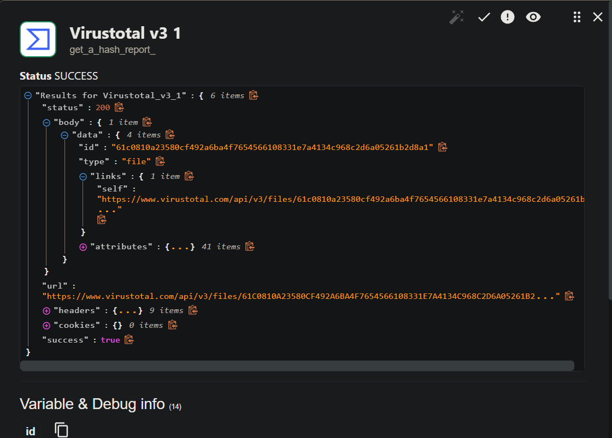 | VirusTotal node returned HTTP `200` | Existing recovered screenshot |
| 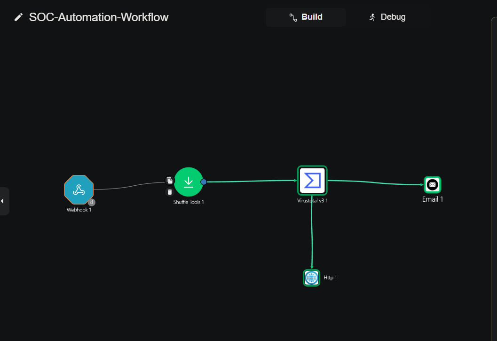 | Workflow topology; VirusTotal branches separately to Email and HTTP | Existing recovered screenshot |
| 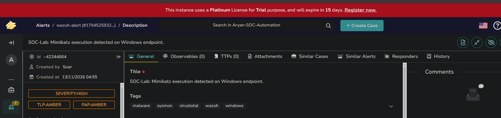 | TheHive UI displayed an alert with the project title and High/TLP/PAP labels | Earlier UI validation; not the exact same alert ID as the latest HTTP response |
| 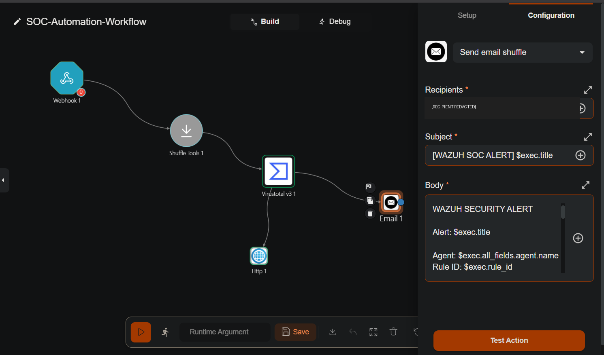 | Email action fields/mappings | Recipient redacted |
| 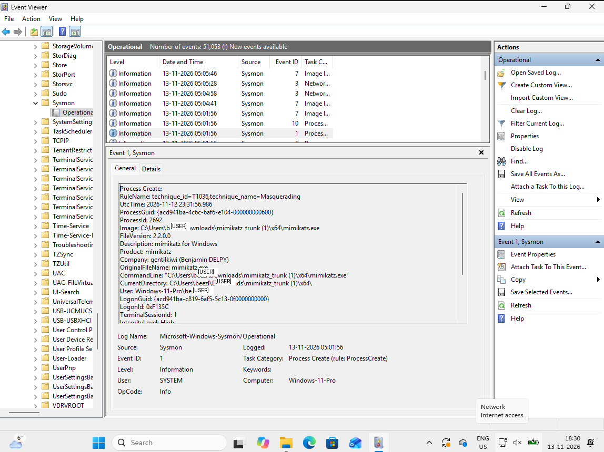 | Sysmon Process Create event for `mimikatz.exe` | Windows username redacted |
| 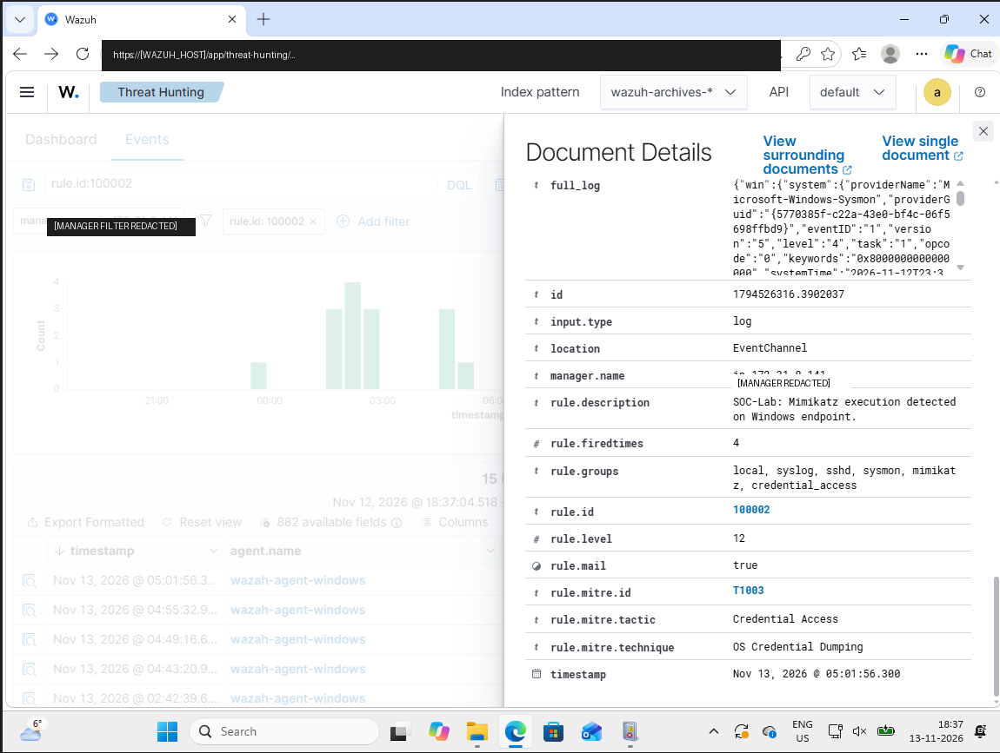 | Wazuh Threat Hunting shows rule `100002`, Level `12`, T1003 | Dashboard address and manager identifiers redacted |
| 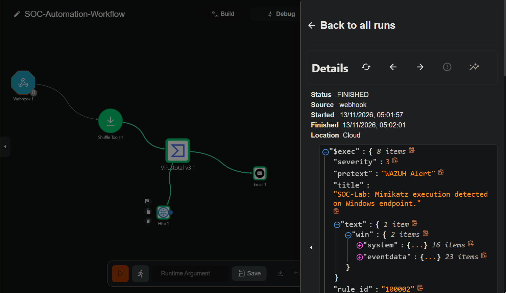 | Shuffle run status `FINISHED`, start and finish times | Debug view |
| 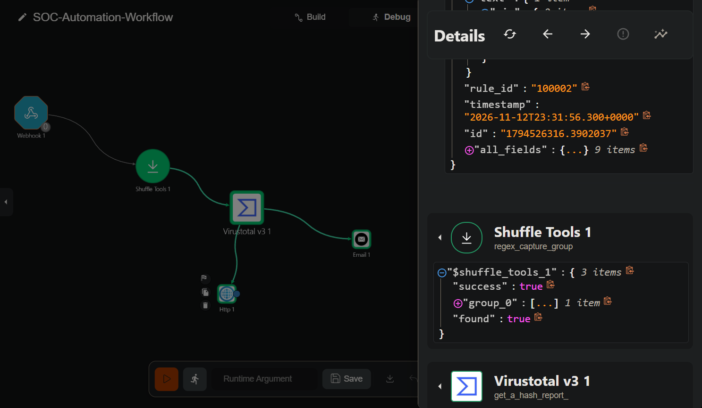 | Shuffle Tools returned `success: true`, `found: true` | Debug node result |
| 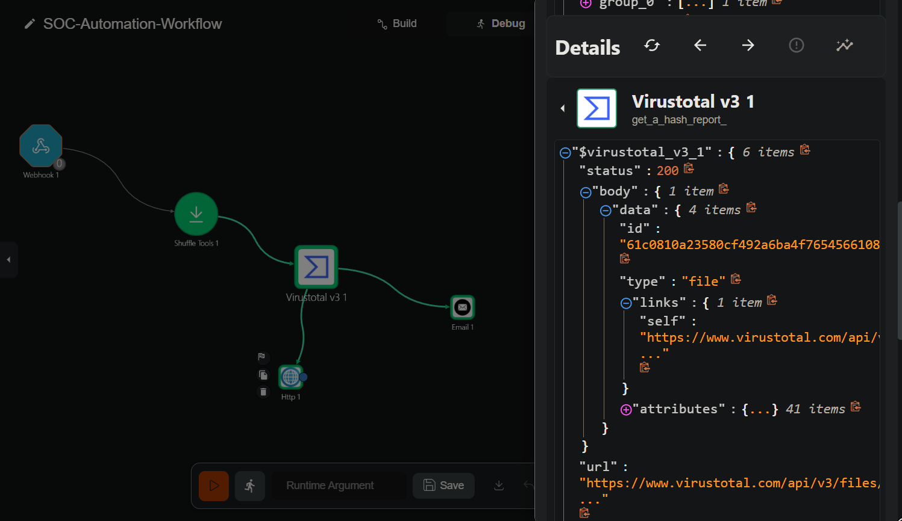 | VirusTotal node returned `200`, `success: true` | Debug node result |
| 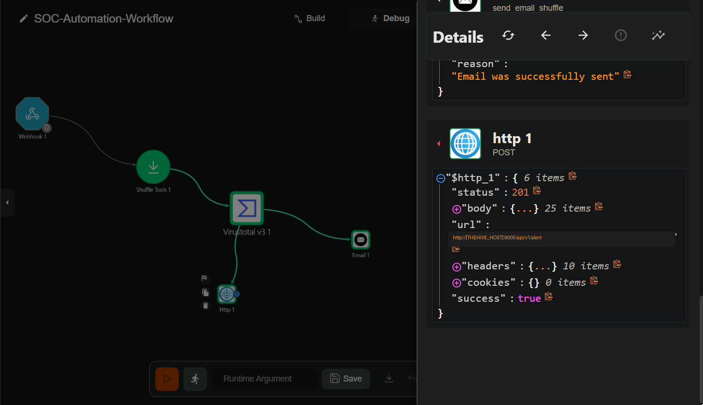 | HTTP `201`, HTTP success, and Email successfully sent | TheHive host redacted |
| 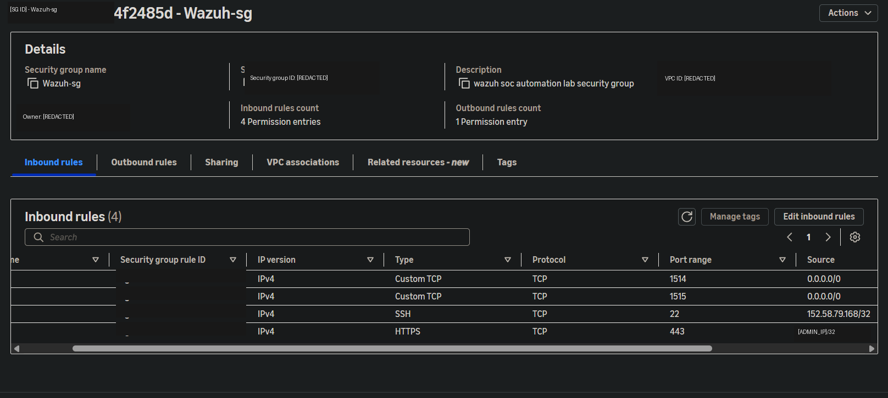 | Inbound rules for Wazuh ports 1514/1515 and admin ports | AWS identifiers/admin IP redacted; `0.0.0.0/0` retained |
| 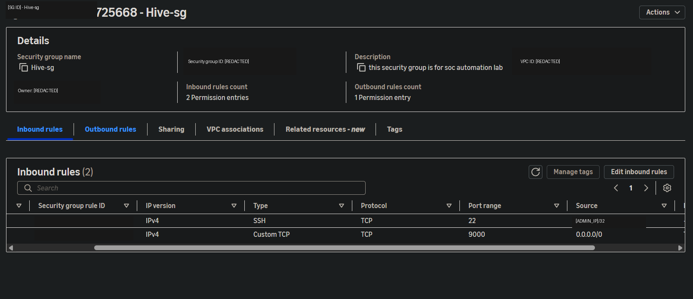 | Inbound rules for TheHive port 9000 | AWS identifiers/admin IP redacted; `0.0.0.0/0` retained |
| 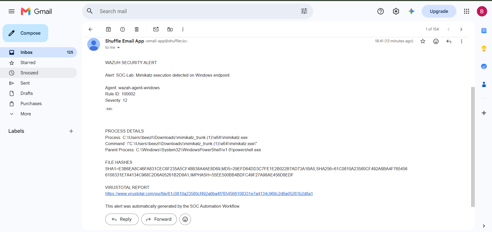 | Gmail inbox showing successful delivery of the Wazuh alert notification | Direct email evidence |

## Structured evidence

- `../samples/wazuh-alert-100002.json`: sanitized Wazuh alert JSON supplied by the project owner.
- `../samples/virustotal-report-summary.json`: normalized subset of the actual Shuffle VirusTotal node output; not the full raw API JSON.
- `../samples/virustotal-node-output-capture.txt`: text capture of the VirusTotal node result.
- `../samples/thehive-alert-creation-response.json`: sanitized representation of the HTTP 201 TheHive response supplied by the project owner.
- `../samples/shuffle-execution-summary.json`: transcription of the successful Shuffle Debug run; not raw execution JSON.
- `../playbooks/SOC-Automation-Workflow.sanitized.json`: sanitized copy of the actual exported workflow; not directly importable because credentials/endpoints are placeholders.

The Gmail inbox screenshot is included as `16-email-notification-delivered.png` and provides direct evidence of email delivery.

## Not claimed as evidence

- Successful credential dumping or credential compromise.
- Automated endpoint containment or remediation.
- A TheHive case creation (the workflow created an alert).
- A completed negative/false-positive test for benign processes.
- A complete VirusTotal antivirus detection ratio (aggregate stats were not visible in the copied result).
